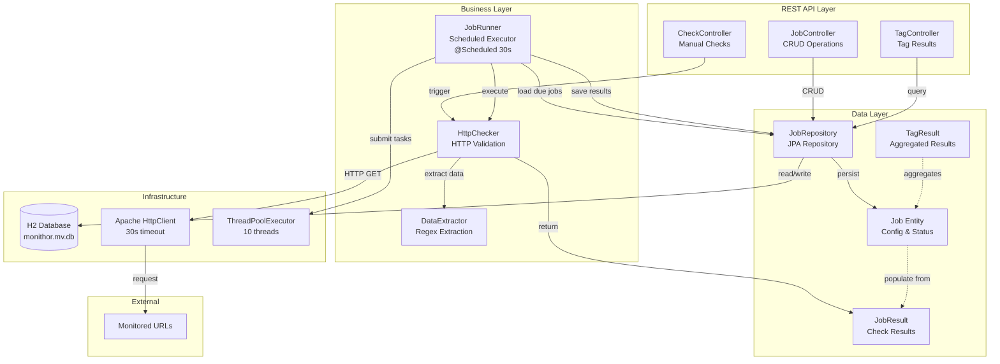

# Monithor Server - Project Overview

## Component Diagram

## Project Description

Monithor is a monitoring application that periodically checks HTTP endpoints for availability and content validation. It's built as a Spring Boot application with a RESTful API backend that manages monitoring jobs and executes scheduled health checks.

## Technology Stack

- **Framework**: Spring Boot 1.4.1
- **Language**: Java 8
- **Build Tool**: Maven
- **Database**: H2 (embedded)
- **ORM**: Hibernate/JPA
- **HTTP Client**: Apache HttpClient 4.5.2
- **Utilities**: Lombok, Jackson
- **Testing**: JUnit, AssertJ, Spring Boot Test

## Architecture Overview

The application follows a typical Spring Boot layered architecture:

### Core Components

#### 1. Main Application (`Monithor.java`)
- Entry point: `src/main/java/org/korhan/monithor/Monithor.java:23`
- Configures Spring Boot with scheduling and async execution enabled
- Sets up CORS configuration for cross-origin requests
- Provides beans for:
  - HttpClient with 30-second timeout
  - ThreadPoolTaskExecutor with 10 core threads

#### 2. Data Layer (`data/`)

**Model (`data/model/`)**
- `Job.java`: Main entity representing a monitoring job
  - Stores URL, name, match patterns, interval, tags
  - Tracks last execution results (timestamp, success, message, version)
  - `isDue()`: Determines if job should run based on interval
  - `populateFromResult()`: Updates job state from check results

- `JobResult.java`: Result of a job execution (success, error, duration, version)
- `TagResult.java`: Aggregated result by tag

**Persistence (`data/persistence/`)**
- `JobRepository.java`: Spring Data JPA repository for Job CRUD operations
  - Custom query methods for finding by tag, name, etc.

#### 3. Job Runner (`runner/`)

**`JobRunner.java`** (`src/main/java/org/korhan/monithor/runner/JobRunner.java:25`)
- Scheduled task that runs every 30 seconds (configurable via `runner.delay`)
- Main workflow:
  1. Loads due jobs (not disabled, past their interval)
  2. Submits jobs to thread pool using `CompletionService`
  3. Waits for all results
  4. Updates job records with results
  5. Handles timeouts for jobs that don't complete

#### 4. Checker (`check/`)

**`HttpChecker.java`** (`src/main/java/org/korhan/monithor/check/HttpChecker.java:19`)
- Executes HTTP GET requests to job URLs
- Validates response content:
  - `match`: Regex pattern that should/shouldn't be in response
  - `matchFailure`: If true, match pattern should NOT be found
  - `versionMatch`: Extracts version from response
  - `buildTimestampMatch`: Extracts build timestamp
  - `checkDeployment`: Validates SNAPSHOT builds are from today

**`DataExtractor.java`**
- Utility for extracting version and build timestamp using regex patterns

#### 5. REST Controllers (`service/`)

**`JobController.java`** (`src/main/java/org/korhan/monithor/service/JobController.java:20`)
- CRUD operations for jobs
- Endpoints:
  - `GET /jobs/` - Query jobs (with optional queryString)
  - `GET /jobs/{id}` - Get job by ID
  - `GET /jobs/tag/{tag}` - Get jobs by tag
  - `GET /jobs/name/{name}` - Search jobs by name
  - `POST /jobs/` - Create new job
  - `PUT /jobs/{id}` - Update job
  - `DELETE /jobs/{id}` - Delete job
- Auto-converts tags to uppercase

**`CheckController.java`**
- Triggers manual checks for jobs

**`TagController.java`**
- Provides aggregated results by tag

## Database

- **Type**: H2 embedded database
- **File**: `monithor.mv.db` (in working directory)
- **Schema**: Auto-generated/updated by Hibernate
- **Tables**:
  - `JOB` - Main job configuration and status
  - `TAGS` - Many-to-many relationship for job tags

## Configuration

**`application.properties`** (`src/main/resources/application.properties:1`)
- Database: H2 file-based at `./monithor`
- Server port: 8090
- Runner delay: 30000ms (30 seconds)
- Logging: WARN for root, INFO for org.korhan

## Build Process

The Maven build (`pom.xml`) includes:
1. Standard Spring Boot packaging
2. NPM build integration (builds `../monithor-client/` frontend)
3. Copies frontend dist to `target/classes/static` for serving
4. Creates deployment assembly in `saf-delivery/` directory
5. Integration tests using Failsafe plugin

## Key Features

1. **Scheduled Monitoring**: Automatically checks URLs at configured intervals
2. **Flexible Matching**: Supports regex patterns for success/failure validation
3. **Version Tracking**: Extracts and tracks application versions
4. **Deployment Validation**: Can verify SNAPSHOT builds are current
5. **Tag-based Organization**: Jobs can be tagged for grouping
6. **Concurrent Execution**: Multiple jobs run in parallel via thread pool
7. **RESTful API**: Full CRUD operations for job management

## Testing

Test suite includes:
- Unit tests for `HttpChecker` and `DataExtractor`
- Integration tests for all controllers
- Test configuration in `IntegrationTestConfig.java`
- Utilities in `IntegrationTestUtils.java`

## Deployment

Deployment package structure (`saf-delivery/`):
- `bin/start.sh` - Startup script
- `config/application.properties` - Runtime configuration
- Assembled via `src/assembly/assembly.xml`

## Entry Points

- **Application Start**: `Monithor.main()` at `src/main/java/org/korhan/monithor/Monithor.java:27`
- **Scheduled Checks**: `JobRunner.run()` at `src/main/java/org/korhan/monithor/runner/JobRunner.java:38`
- **REST API**: Controllers in `src/main/java/org/korhan/monithor/service/`
